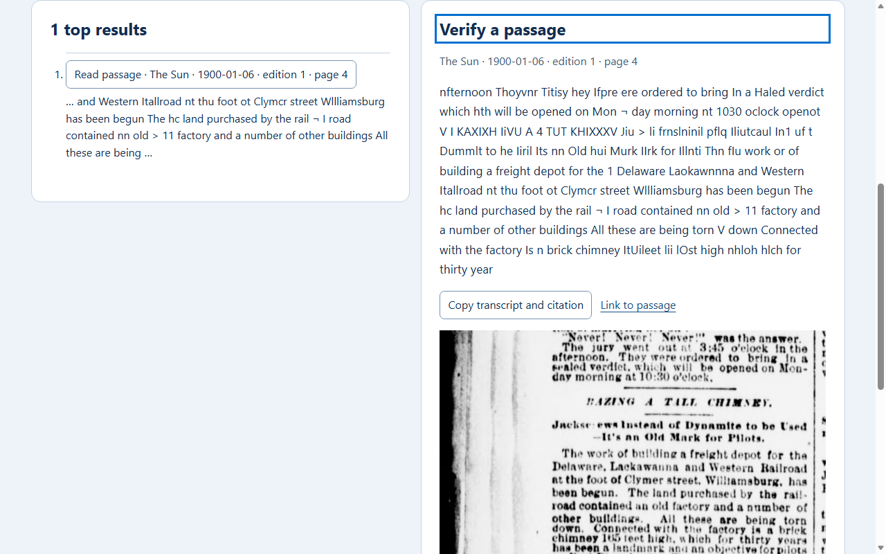

# Accessible Archive Search

A name can be perfectly legible on an old newspaper scan and still disappear from search if the OCR misreads one letter. I built this tool to recover those passages and give readers a direct path from the search result to the part of the original newspaper they can cite.

[Open the tool](https://martaforjaz.github.io/accessible-archive-search/) · [Watch the captioned demo](https://martaforjaz.github.io/accessible-archive-search/#demo)



## Try the search

Choose **Try the Williamsburg example**. The tool searches the January 6, 1900 issue of *The Sun* for a report on rail work at Clymer Street. The OCR reads the name as “Wllliamsburg”. Turn off spelling tolerance to see the exact search miss it. Press Tab and Enter to open a result and compare the OCR with the original scan. You can copy the passage and citation or open its stable link.

## Design

- A Python importer streams the Library of Congress ALTO archive. It chooses the highest-confidence OCR token at each overlapping x position, groups up to 14 lines from each OCR block and stores their normalized bounding box. Page identity is the SQLite primary key. Each committed page is a checkpoint.
- An atomic gzip snapshot publishes up to 40 passages per page. The static website builds a BM25 index in a Web Worker. Optional query expansion finds candidate OCR spellings with character trigrams and a bounded edit-distance or OCR-confusion check. Exact matches retain more weight.
- The reader resolves the illustration through the issue METS manifest and requests a IIIF crop for the selected bounding box. Results and transcripts are keyboard navigable. The OCR transcript stays as published, so readers can see the uncertainty and consult the image before quoting.

## Evaluation

The released snapshot covers **2,200 pages and 87,838 passages**. In 13 date-scoped queries with 14 manually selected reference passages, at least one known passage appeared in the top 10 for **7/13** BM25 queries and **10/13** with OCR tolerance. MRR@10 was **0.50** and **0.66**, respectively. Warm ranking p95 was **0.69 ms** and **1.60 ms** on one local machine. These measurements exclude download and index construction. The test intentionally includes known OCR errors, uses partial judgments, and does not estimate performance across the entire archive. The Brooklyn piano advertisement still fails to rank in the top ten. [Judgments](judgments.json) · [Raw evaluation](evaluation.json)

The recovery test exited the importer immediately after committing 24 pages. On restart, it added the remaining 36 pages in the 60-page test prefix and preserved the original 24 records. Replaying the prefix inserted zero duplicate pages. The latency test queried the published snapshot while a separate importer wrote the recovery batch. New pages become visible when an updated snapshot is exported. [Recovery results](recovery.json)

The Edge browser check exercised the exact miss, fuzzy recovery, keyboard navigation from the results to the transcript, loading the actual scan crop, copying the citation, and reopening a permalink. The refinement after the initial test put a matching term in the result excerpt so a reader could see why the result was retrieved. Testing with human participants and screen readers is pending.

## Reproduce

Use Python 3.11+ and Node.js 24+ from this directory. Download [the Library of Congress OCR batch](https://chroniclingamerica.loc.gov/data/ocr/nn_aristotle_ver01.tar.bz2) as `ny.tar.bz2` to repeat ingestion. The website and ranking evaluation can use the committed snapshot directly.

```sh
python ingest.py ingest ny.tar.bz2 --max-source-pages 2200
python ingest.py export
node evaluate.mjs
node recovery.mjs ny.tar.bz2
python -m http.server 8984
```

Open the URL reported by the server. The initial archive download is about 36 MB, and the crop requires access to Library of Congress image services. Stop the local server before running `node browser-check.mjs`, which launches its own server and headless Edge. Set `EDGE_PATH` to override the default Edge installation. Set `ARCHIVE_RECORD` to a new empty folder to capture the demonstration frames.

Source: Library of Congress, [Chronicling America: Historic American Newspapers](https://www.loc.gov/collections/chronicling-america/) and [collection rights information](https://www.loc.gov/collections/chronicling-america/about-this-collection/rights-and-access/). Historical text may contain outdated or offensive terminology.
